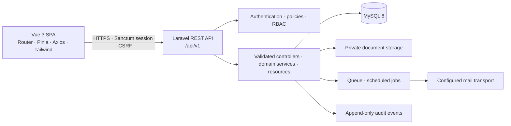

# HRM architecture and API plan

## 1. Requirements and boundaries

This application manages a company's employee lifecycle and HR operations:
employees, organizational structure, contracts, attendance, leave, payroll,
performance reviews, recruitment, and operational reports.

The initial product is for one company. Its records share one organization
scope; there is no tenant identifier or cross-company data access. Multi-tenant
hosting would require a separately designed isolation and authorization model.

Every listed module is planned, not implemented. Work is divided into the phases
in [the project README](../README.md); each phase must be tested before the next
begins.

## 2. System architecture



### Application boundaries

- Keep `backend/` and `frontend/` as separate applications in this repository.
- Laravel owns persistence, validation, authorization, calculations, workflow
  transitions, audit events, and API response shapes. The browser is never the
  source of truth for payroll or leave balances.
- The Vue application owns navigation, accessible forms, client-side field
  feedback, loading/error/empty states, and presentation. It uses Axios API
  services and Pinia stores rather than static business data.
- Use Laravel API Resources for stable response shapes, Form Requests for
  request validation, Policies for record-level access, and small domain
  services for workflows requiring transactions or locks.
- Use MySQL foreign keys and unique constraints as a second integrity boundary;
  database constraints do not replace authorization or business validation.
- Use private object/local storage for employee documents. Serve them only
  through authorized, short-lived downloads; never expose storage paths publicly.
- Use queues for long-running exports and notifications. Persist export status
  and scope, and re-check access when generating and retrieving an export.

### Authentication and deployment

- Use Sanctum stateful session authentication for the first-party SPA, secure
  HttpOnly cookies, CSRF token validation, HTTPS, and an explicit stateful
  domain/CORS allowlist.
- Deploy the SPA and API on the same site, preferably behind a reverse proxy,
  even if they are separate services. Do not store session credentials in
  `localStorage`.
- Configure a non-demo Super Administrator through a controlled deployment
  process. Seed roles, permissions, and fake development fixtures separately;
  refuse demo seeding in production.
- Hash passwords with Laravel's configured password hasher. Rate-limit
  authentication and sensitive endpoints, validate uploads by content and
  size, and keep application secrets outside source control.
- Enforce RBAC in policies on every request. UI visibility is not an
  authorization mechanism.

## 3. Authorization model

Use seeded roles and permissions with `roles`, `permissions`,
`permission_role`, and `role_user` tables. Role assignments are global; derive
department scope from the employee/department manager relationships rather
than trusting a client-supplied scope. Never trust a client-supplied role.

| Role | Intended access |
|---|---|
| Super Administrator | System configuration, users and access control, and audited administrative access |
| HR Manager | Employee, department, position, contracts, attendance, leave, performance, recruitment, and authorized HR reports |
| Department Manager | Limited employee directory for their department; attendance and leave decisions for reports directed to them; assigned performance reviews |
| Accountant | Payroll configuration and processing, salary data required for payroll, payslips, and financial reports |
| Employee | Own profile's permitted fields, attendance, leave requests and balances, objectives/reviews released to them, and own payslips |

Permissions represent actions (`employees.view`, `employees.create`,
`payroll.approve`, and similar), not just pages. Policies additionally scope
department managers and employees to records they are allowed to access.

- Managers may approve only requests within their assigned scope. Resolve the
  manager from the employee's `manager_id`; do not accept a manager identity
  from the request body.
- An actor cannot approve their own leave request, payroll run, or other
  approval that they initiated.
- A manager's direct reports and managed departments are checked on the server
  at decision time. Department-wide access is a separate permission, not
  inferred from a UI filter.
- Salary structures, payroll calculations, payroll exports, and payslips use
  dedicated policies and response resources that omit salary fields for
  unauthorized roles.
- Permission changes, elevated access, employment changes, approval
  decisions, payroll processing, and sensitive downloads are audited.

## 4. Domain model

The normalized schema is described in the
[database design](database-design.md). Main boundaries:

- **Identity:** users, roles, permissions, and their pivots.
- **Organization:** departments, positions, employees, contracts, contacts,
  and private documents.
- **Time and leave:** daily attendance, leave types, requests, yearly balances,
  and balance transactions.
- **Compensation:** effective-dated salary structures and component snapshots
  inside uniquely processed payroll runs.
- **People development:** review cycles, objectives, and performance reviews.
- **Recruitment:** vacancies, candidates, applications, and interviews.
- **Governance:** append-only audit events and company calendar events.

Keep salary and identity-account data out of the employee profile row.
Historical payroll items are immutable calculation snapshots; later salary
changes must not rewrite them.

## 5. API conventions

All endpoints are JSON under `/api/v1`. Authenticated browser calls use the
Sanctum session and CSRF cookie flow. Use resource-oriented naming, standard
HTTP status codes, consistent validation errors, bounded pagination, and
whitelisted sort fields. Filter, sort, and pagination parameters are inputs,
not SQL fragments.

### Identity

| Method | Endpoint | Purpose |
|---|---|---|
| GET | `/api/v1/health` | Liveness check without sensitive application data |
| GET | `/sanctum/csrf-cookie` | Initialize browser CSRF protection |
| POST | `/api/v1/auth/login` | Authenticate and rotate session |
| POST | `/api/v1/auth/logout` | Revoke the current session |
| GET | `/api/v1/auth/me` | Return the authenticated user's authorized identity and permissions |

### Organization and employees

| Method | Endpoint | Purpose |
|---|---|---|
| GET, POST | `/api/v1/employees` | Search/list and register employees |
| GET, PUT, DELETE | `/api/v1/employees/{employee}` | Read, update, and authorized soft-deactivate/archive |
| GET, POST | `/api/v1/employees/{employee}/contracts` | View or add employment contract history |
| GET, POST | `/api/v1/employees/{employee}/documents` | List or upload private documents |
| GET, DELETE | `/api/v1/employees/{employee}/documents/{document}` | Authorized download or removal |
| GET, POST | `/api/v1/departments` | Search/list or create departments |
| GET, PUT, DELETE | `/api/v1/departments/{department}` | Read, update, or retire a department |
| GET, POST | `/api/v1/positions` | Search/list or create job positions |
| GET, PUT, DELETE | `/api/v1/positions/{position}` | Read, update, or retire a position |

### Attendance and leave

| Method | Endpoint | Purpose |
|---|---|---|
| GET | `/api/v1/attendance` | Authorized, filterable attendance history and reports |
| POST | `/api/v1/attendance` | Record or clock an employee's attendance |
| PUT | `/api/v1/attendance/{attendance}` | Correct a record with an audit reason |
| GET, POST | `/api/v1/leave-types` | List or manage leave types (HR permissions) |
| GET, POST | `/api/v1/leave-requests` | View authorized requests or submit a request |
| GET, PUT | `/api/v1/leave-requests/{leaveRequest}` | View or update a pending request |
| POST | `/api/v1/leave-requests/{leaveRequest}/approve` | Approve through the scoped workflow |
| POST | `/api/v1/leave-requests/{leaveRequest}/reject` | Reject with a reason |
| POST | `/api/v1/leave-requests/{leaveRequest}/cancel` | Cancel an eligible request |
| GET | `/api/v1/employees/{employee}/leave-balances` | View authorized balance and ledger |

### Payroll and compensation

| Method | Endpoint | Purpose |
|---|---|---|
| GET, POST | `/api/v1/salary-structures` | View or manage effective-dated salary structures (restricted) |
| GET, POST | `/api/v1/payroll-runs` | List runs or prepare a period preview |
| GET | `/api/v1/payroll-runs/{payrollRun}` | View an authorized run and summary |
| POST | `/api/v1/payroll-runs/{payrollRun}/process` | Lock eligible employees, calculate, and persist the period |
| POST | `/api/v1/payroll-runs/{payrollRun}/approve` | Approve a processed run by a separate authorized actor |
| POST | `/api/v1/payroll-runs/{payrollRun}/void` | Void an eligible run with an audited reason; never erase its history |
| GET | `/api/v1/payroll-records/{payrollRecord}` | Read an authorized employee payroll record |
| GET | `/api/v1/payroll-records/{payrollRecord}/payslip` | Generate or download an authorized payslip |

There are no assumed statutory tax rates. Configure tax/deduction components as
effective-dated rules; preview a period before processing. Payroll calculation
uses decimal arithmetic and the stated equation:
`net = basic + allowances + overtime - deductions`.

### Performance, recruitment, dashboard, and reports

| Method | Endpoint | Purpose |
|---|---|---|
| GET, POST | `/api/v1/review-cycles` | List or manage review cycles |
| GET, POST | `/api/v1/objectives` | List authorized objectives or create one |
| GET, POST | `/api/v1/performance-reviews` | List or create scoped reviews |
| PUT | `/api/v1/performance-reviews/{performanceReview}` | Submit/update an eligible review |
| GET, POST | `/api/v1/job-vacancies` | List or manage vacancies |
| GET, PUT | `/api/v1/job-applications/{jobApplication}` | View or move an application through permitted stages |
| GET, POST | `/api/v1/job-vacancies/{jobVacancy}/applications` | List or create applications |
| GET, POST | `/api/v1/job-applications/{jobApplication}/interviews` | List or schedule interviews |
| GET | `/api/v1/dashboard` | Return aggregates visible to the authenticated role |
| GET | `/api/v1/reports/{report}` | Request an authorized report/export |
| GET | `/api/v1/exports/{export}` | Retrieve a completed export after reauthorization |

Sensitive reports and downloads are permission-checked both when requested and
when retrieved. Export filters and selected fields are constrained by policy.

## 6. Frontend structure

```text
frontend/src/
  components/       # tables, form fields, modal, pagination, badges, toasts
  composables/      # shared query and form behavior
  layouts/          # authenticated application shell and login layout
  pages/            # role-scoped route pages by module
  router/           # guarded route definitions and breadcrumbs
  services/         # Axios client and typed/resource API modules
  stores/           # auth, notifications, and focused UI state
```

Use route metadata for navigation and permission-aware rendering, but always
enforce access on the API. Forms show server validation errors; destructive and
approval operations require confirmation and display the resulting status.

## 7. Backend structure

```text
backend/app/
  Http/Controllers/Api/V1/
  Http/Requests/Api/V1/
  Http/Resources/Api/V1/
  Models/
  Policies/
  Services/          # transactional domain workflows
  Jobs/              # report generation and notifications
  Notifications/
backend/database/
  factories/
  migrations/
  seeders/
```

Controllers should remain thin: authorize, validate through a Form Request,
invoke the relevant service when business invariants span multiple writes, and
return an API Resource. Use explicit transactions and row locks for leave
approvals, balance updates, and payroll processing. Log handled failures
through Laravel's reporting mechanisms; never convert an authorization or
calculation failure into a success response.

## 8. Operational and implementation sequence

1. **Phase 1:** requirements, boundaries, architecture, authorization, and API
   contract (this document).
2. **Phase 2:** normalized relational model, constraints, and ER diagram
   ([database design](database-design.md)).
3. **Phase 3:** independently scaffold the Laravel API and Vue SPA; configure
   local MySQL, migrations, formatting, and test commands.
4. **Phase 4:** session authentication, users/roles/permissions, policies,
   authorization tests, and controlled initial administrator provisioning.
5. **Phase 5:** employee, department, position, contract, document, and
   directory flows.
6. **Phase 6:** attendance, leave requests, approval scopes, balance ledger,
   and overlap/concurrency tests.
7. **Phase 7:** compensation setup, payroll preview/calculation, approval,
   idempotency, protected payslips, and decimal-accuracy tests.
8. **Phase 8:** performance cycles/objectives/reviews and recruitment through
   interview and hiring decisions.
9. **Phase 9:** role-scoped dashboard, reports, exports, and activity views.
10. **Phase 10:** end-to-end testing, security review, deployment/backup
    procedures, and installation/API documentation based on actual behavior.

Each phase includes backend tests, authorization tests for affected roles,
frontend loading/error/empty states, and a review of migrations and constraints.
No placeholder control is considered a completed feature.
