# HRM database design

## Scope and conventions

The schema targets MySQL 8/InnoDB and one company. It is a design for future
migrations, not an assertion that migrations already exist.

- Use unsigned bigint primary/foreign keys unless an external identifier
  requires otherwise. Use UTC timestamps for instants; store work dates,
  employment dates, leave days, and payroll periods as SQL `DATE` values in the
  company's configured timezone.
- Store money as `DECIMAL(13,2)` with an ISO 4217 currency code. Never use
  binary floating point for money. Store the currency on salary structures
  and payroll runs; reject a run whose contributing structures use another
  currency unless explicit conversion is implemented.
- Add `created_at` and `updated_at` to mutable records. Use soft deletes for
  directory/configuration records where historical references must remain
  queryable. Do not cascade-delete audit events, contracts, or processed
  payroll history.
- Name foreign keys explicitly and index foreign keys, common filters, and
  date ranges. Keep PII and sensitive compensation in narrowly permissioned
  resources.
- Database `CHECK` constraints may reinforce nonnegative amounts and valid date
  ranges; Laravel validation and policies remain required.

## ER diagram

```mermaid
erDiagram
  USERS ||--o| EMPLOYEES : account
  USERS ||--o{ ROLE_USER : assigned
  ROLES ||--o{ ROLE_USER : includes
  ROLES ||--o{ PERMISSION_ROLE : grants
  PERMISSIONS ||--o{ PERMISSION_ROLE : assigned
  USERS ||--o{ AUDIT_LOGS : acts
  EMPLOYEES o|--o{ DEPARTMENTS : manages
  DEPARTMENTS ||--o{ POSITIONS : contains
  DEPARTMENTS ||--o{ EMPLOYEES : employs
  EMPLOYEES o|--o{ EMPLOYEES : manages
  POSITIONS ||--o{ EMPLOYEES : classifies
  EMPLOYEES ||--o{ EMPLOYMENT_CONTRACTS : contracts
  EMPLOYEES ||--o{ EMPLOYEE_DOCUMENTS : owns
  EMPLOYEES ||--o{ EMERGENCY_CONTACTS : lists
  EMPLOYEES ||--o{ ATTENDANCE : records
  EMPLOYEES ||--o{ LEAVE_REQUESTS : submits
  LEAVE_TYPES ||--o{ LEAVE_REQUESTS : categorizes
  EMPLOYEES ||--o{ LEAVE_REQUESTS : reviews
  EMPLOYEES ||--o{ LEAVE_BALANCES : accrues
  LEAVE_TYPES ||--o{ LEAVE_BALANCES : defines
  LEAVE_BALANCES ||--o{ LEAVE_BALANCE_TRANSACTIONS : ledger
  EMPLOYEES ||--o{ SALARY_STRUCTURES : compensated
  SALARY_STRUCTURES ||--o{ SALARY_STRUCTURE_COMPONENTS : contains
  PAY_COMPONENTS ||--o{ SALARY_STRUCTURE_COMPONENTS : assigned
  PAYROLL_RUNS ||--o{ PAYROLL_RECORDS : produces
  EMPLOYEES ||--o{ PAYROLL_RECORDS : paid
  PAYROLL_RECORDS ||--o{ PAYROLL_ITEMS : snapshots
  PAY_COMPONENTS o|--o{ PAYROLL_ITEMS : source
  REVIEW_CYCLES o|--o{ PERFORMANCE_OBJECTIVES : defines
  EMPLOYEES ||--o{ PERFORMANCE_OBJECTIVES : owns
  REVIEW_CYCLES ||--o{ PERFORMANCE_REVIEWS : schedules
  EMPLOYEES ||--o{ PERFORMANCE_REVIEWS : reviewed
  EMPLOYEES ||--o{ PERFORMANCE_REVIEWS : reviewer
  JOB_VACANCIES ||--o{ JOB_APPLICATIONS : receives
  CANDIDATES ||--o{ JOB_APPLICATIONS : applies
  JOB_APPLICATIONS ||--o{ INTERVIEWS : schedules
  USERS o|--o{ INTERVIEWS : interviewer
```

`EMPLOYEES.manager_id` is a nullable self-reference and may point only to an
active employee under policy. Manager scope is verified in application logic.

## Tables and constraints

### Identity and access control

| Table | Important fields and constraints |
|---|---|
| `users` | `name`, unique `email`, `password`, `status`, `last_login_at`; password is always hashed. |
| `roles` | Unique `name`, description, system-managed flag. Seed the named system roles. |
| `permissions` | Unique machine-readable permission `name`, description. |
| `role_user` | `role_id`, `user_id`, timestamps; unique `(role_id,user_id)`. Department scope is derived from the employee manager and department relationships. |
| `permission_role` | Unique `(permission_id,role_id)`; only controlled role administration can mutate grants. |

Do not accept a department scope from the request body as an authorization
grant. If scoped role assignments become a product requirement, model them as a
separate, explicitly constrained relation.

### Organization and employee records

| Table | Important fields and constraints |
|---|---|
| `departments` | Unique code and name, optional `manager_employee_id`, status, description, timestamps, `deleted_at`. The manager FK is added after employees exist. |
| `positions` | `department_id`, unique `(department_id,code)` and `(department_id,name)`, plus unique `(id,department_id)` for the employee composite FK; title, description, level, status, timestamps, `deleted_at`. |
| `employees` | Unique employee number; optional unique nullable `user_id`; first/middle/last name; gender and birth date; unique nullable work email; phone/address; required `department_id` and `position_id`; composite FK `(position_id,department_id)` to `positions(id,department_id)`; nullable self-referencing `manager_id`; employment type/status; joined and optional end dates; timestamps and `deleted_at`. |
| `employment_contracts` | Employee FK, contract type, start/end dates, status, private storage reference for signed contract, creator; index `(employee_id,start_date,end_date)`; no salary embedded in a public employee response. |
| `employee_documents` | Employee FK, private disk/path, original name, detected MIME type, size, category, checksum, uploader, timestamps; never expose a public URL. |
| `emergency_contacts` | Employee FK, contact name, relationship, phone/email, priority; index employee and priority. |

Use `RESTRICT` on department/position deletes while employees refer to them;
archive them instead. Department manager and employee foreign keys are nullable
so organizations can be configured without circular creation dependencies.

### Attendance and leave

| Table | Important fields and constraints |
|---|---|
| `attendance` | Employee FK, `work_date`, clock-in/out instants, status (`present`, `absent`, `late`, `half_day`, `on_leave`), correction reason and actor, timestamps; unique `(employee_id,work_date)`, indexes `(work_date,status)` and `(employee_id,work_date)`. |
| `leave_types` | Unique code/name, paid flag, approval-required flag, optional yearly allowance, carryover configuration, status, timestamps, `deleted_at`. |
| `leave_requests` | Employee and leave-type FKs, inclusive start/end dates, requested amount, reason, status (`pending`, `approved`, `rejected`, `cancelled`), submitted/decided timestamps, decision actor/reason, timestamps; indexes employee/date range, status/date, reviewer. |
| `leave_balances` | Employee, leave type, leave year, granted, carry-in, used, pending, version/timestamps; unique `(employee_id,leave_type_id,leave_year)`. Derive availability from the ledger or maintain these totals transactionally. |
| `leave_balance_transactions` | Balance FK, optional leave-request FK, type, signed decimal day amount, effective date, actor, idempotency key; unique idempotency key; immutable ledger rows. |

MySQL does not provide a simple exclusion constraint for overlapping date
ranges. Before approving paid leave, lock the employee and relevant balance
rows in a transaction, query overlapping approved requests, reject collisions,
then append the balance-ledger entries and update cached totals. The lock and
overlap query must use the same transaction. Reject self-approval in policy and
again in the transition service. Define how half-days and cross-year requests
allocate against yearly balances before implementing leave (Phase 6).

The unique attendance key guarantees at most one daily record per employee.
Clock corrections, imports, and administrative changes must leave a reason and
audit event.

### Compensation and payroll

| Table | Important fields and constraints |
|---|---|
| `pay_components` | Unique code, name, kind (`allowance`, `deduction`, `overtime`, `tax`), calculation mode/value, currency where applicable, taxable flag, configurable effective dates, active flag. No jurisdictional rate is assumed. |
| `salary_structures` | Employee FK, effective start/end dates, basic amount `DECIMAL(13,2)`, ISO currency, creator and timestamps; index `(employee_id,effective_from,effective_to)`; constrain effective ranges from overlapping for one employee. |
| `salary_structure_components` | Salary structure FK, pay component FK, configured amount/rate and calculation basis; unique `(salary_structure_id,pay_component_id)`; effective rules are snapshotted when payroll is processed. |
| `payroll_runs` | Period start/end dates, company currency, status (`draft`, `processing`, `processed`, `approved`, `void`), prepared/processed/approved actors and timestamps, totals, audited void reason; unique `(period_start,period_end)` and check start <= end. The company uses one configured payroll currency. |
| `payroll_records` | Payroll run and employee FKs, immutable employee/name/employee-number snapshots, basic, allowance, overtime, total deduction (including any configured tax withholding), and net totals, status; unique `(payroll_run_id,employee_id)`. Exclude inactive/deactivated employees at processing time. |
| `payroll_items` | Payroll record FK, optional source pay component FK, line type, description/code snapshots, quantity/rate, amount and explicit earning/deduction kind, currency, calculation metadata JSON; retain snapshots when configuration changes. Tax is a configured deduction component, not an extra subtraction outside total deductions. |

The unique payroll-record key prevents duplicate pay for an employee within a
run; the payroll-run key prevents duplicate runs for the same date period.
Process a run transactionally: lock the draft run, select active
employees with an effective salary structure, snapshot component rules,
calculate with decimal-safe operations, insert one record per employee, and
change run state. A retry of a processed/approved run must not recalculate it.
Approval requires a different authorized actor. Corrections use an audited
void/replacement process rather than editing approved records.

Net salary is `basic + allowances + overtime - total deductions`, where total
deductions include configured tax withholding. This is the specified formula;
tax is not subtracted a second time. Component sign conventions must be
explicit and consistent; never infer legal tax treatment from the application.

### Performance and recruitment

| Table | Important fields and constraints |
|---|---|
| `review_cycles` | Unique code/name, start/end dates, status, created by; date checks. |
| `performance_objectives` | Employee and optional cycle FKs, creator, title, measurable description, due date, weight, status, timestamps; index employee/cycle/status. |
| `performance_reviews` | Employee, cycle, reviewer employee FKs, rating, feedback, status, submitted/released timestamps; unique `(employee_id,review_cycle_id,reviewer_employee_id)`; no self-review. |
| `job_vacancies` | Position FK, unique code, title snapshot, description, openings, open/close dates, status, creator. |
| `candidates` | Name and contact details, timestamps; indexed email/phone, with duplicate-candidate resolution handled by application policy. |
| `job_applications` | Vacancy and candidate FKs, stage/status, applied date, source, notes, decision actor/time; unique `(job_vacancy_id,candidate_id)` unless reapplication policy explicitly permits more than one. |
| `interviews` | Application FK, scheduled start/end instants, interviewer user FK, outcome, feedback, timestamps; indexes application/time and interviewer/time. |

When a candidate is hired, create the employee and link the accepted
application in a transaction; retain the recruitment history.

### Governance and company calendar

| Table | Important fields and constraints |
|---|---|
| `audit_logs` | Nullable actor FK, action, subject type/id, request/correlation id, safe before/after JSON, reason, IP/user-agent as permitted by retention policy, created timestamp; indexes actor/time and subject/time; append-only at application and database privilege levels. |
| `company_events` | Title, description, start/end instants, audience/scope, creator, timestamps, `deleted_at`; index start time and visibility. This supplies upcoming dashboard events without hard-coded data. |

Do not put passwords, session identifiers, document contents, or unnecessary
salary/medical details in audit JSON. Protect audit access and define retention.

## Migration and delete strategy

Create migrations in dependency order: identity/access; organization tables;
employees; add employee-dependent department-manager FK; contracts/documents;
attendance and leave types; leave requests/balances/ledger; compensation
configuration; payroll runs/records/items; performance; recruitment; audit and
events. Use reversible migrations and explicit FK delete/update behavior.

Soft-delete employees, departments, positions, and configuration where history
needs to be retained. Do not allow a soft-deleted employee to authenticate,
appear as an active payroll candidate, or receive new attendance/leave records.
Use `RESTRICT` for financial, approval, and audit history. Never cascade-delete
processed payroll, balance ledger, or audit rows.

## Integrity and tests required before implementation is complete

- Unique employee number and optional account/work-email constraints.
- Department/position consistency for each employee.
- Unique `(employee_id,work_date)` attendance.
- Overlap checks with concurrent approval tests and balance-ledger idempotency.
- Unique payroll period and employee/run; concurrent processing and retry
  idempotency tests.
- Decimal precision, effective salary dates, configured deductions, and
  inactive employee exclusion tests.
- Role, department scope, self-approval, salary visibility, and private-document
  access tests for every affected endpoint.
- Soft-delete behavior, foreign-key deletion rules, audit immutability, and
  report/export reauthorization tests.
